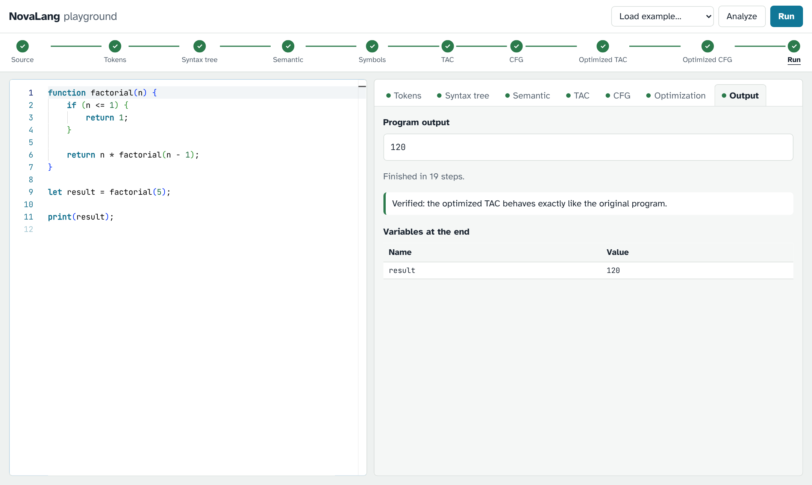
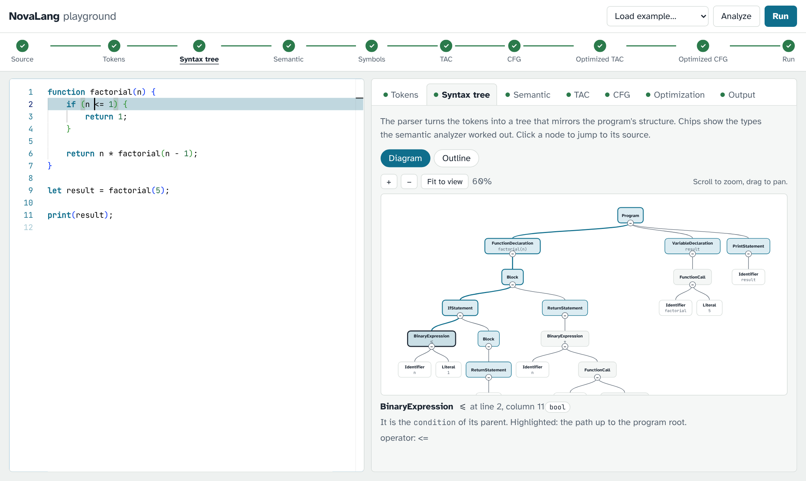
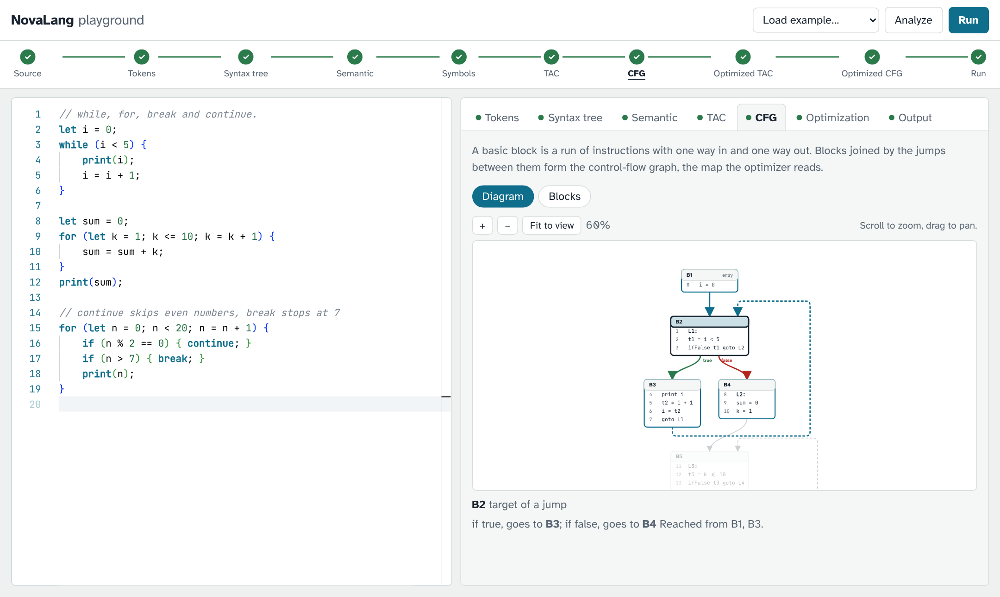
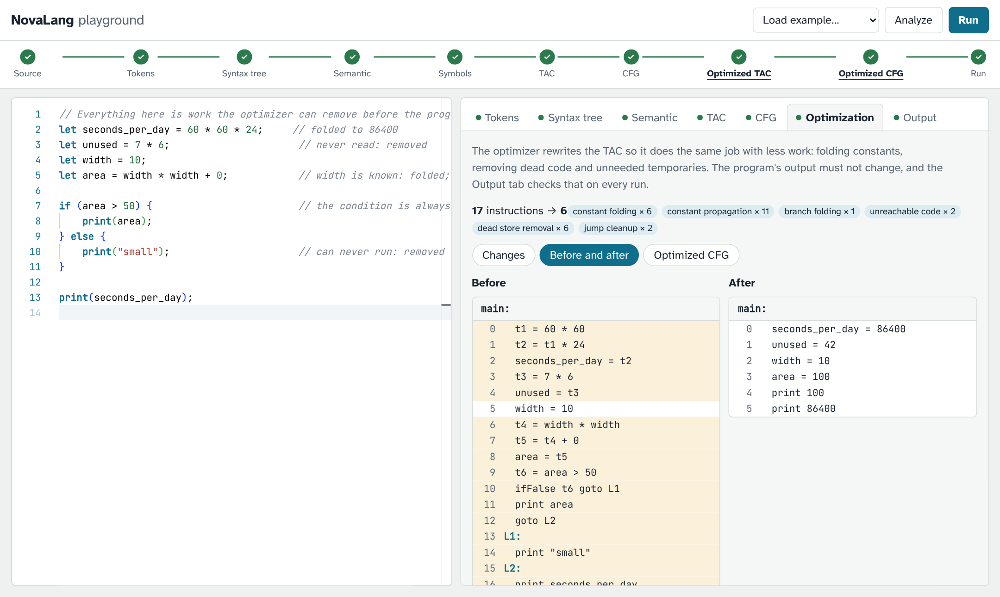

# NovaLang

NovaLang is a small programming language with a compiler you can look inside. Type a program, press **Run**, and see every stage the compiler went through: tokens, syntax tree, type checks, intermediate code, control-flow graph, optimizations, and finally the output.

It is a college compiler-design project, built so that each stage is small enough to read and test on its own.



## Try it in three minutes

Developed and tested with Python 3.13 and, for the web playground, Node 22.

```bash
pip install -r requirements.txt
pytest                                   # 869 tests, about 15 seconds
python -m compiler examples/demo_factorial.nova      # all ten stages, in the terminal
```

For the web playground, open two terminals in the project folder:

```bash
uvicorn backend.main:app --port 8000     # the compiler as a web API (docs at /docs)
```
```bash
cd frontend
npm install
npm run dev                              # open http://localhost:5173
```

Pick **Load example...** in the top bar, then press **Run** (or Ctrl+Enter).

## The language

```
function factorial(n) {
    if (n <= 1) {
        return 1;
    }
    return n * factorial(n - 1);
}

let result = factorial(5);
print(result);                  // 120
```

Variables (`let`), integers, floats, strings, booleans, `nil`, arrays, functions with recursion, `if`/`else`, `while`, `for`, `break`, `continue`, and `print`. Every body needs braces and every statement ends with `;`. The full rules and the grammar are in [docs/01_language_spec.md](docs/01_language_spec.md); more programs are in [`examples/`](examples).

## The ten stages

```
source -> tokens -> syntax tree -> semantic analysis -> symbol table
       -> three-address code -> basic blocks & CFG
       -> optimized code -> optimized CFG -> execution
```

| Stage | What it does | Where |
|---|---|---|
| Tokens | Splits characters into words and symbols, remembering line and column | `compiler/lexer` |
| Syntax tree | Builds the program's structure by recursive descent | `compiler/parser` |
| Semantic analysis | Checks names, scopes and types; warns about dead code | `compiler/semantic` |
| Three-address code | Flattens the tree into simple steps with temporaries and jumps | `compiler/ir/generator.py` |
| Basic blocks and CFG | Cuts the code at jumps and joins the pieces into a graph | `compiler/ir/basic_blocks.py` |
| Optimization | Folds constants, removes dead code, using data-flow analysis | `compiler/optimizer` |
| Execution | Runs the program, and checks the optimized code prints the same | `compiler/interpreter`, `compiler/ir/tac_runner.py` |

If a stage fails, the compiler stops there, says why, and marks the later stages as skipped. Errors point at the exact spot in your code and say how to fix it:

```
Syntax Error: Expected ';' after variable declaration.

  2 | let total = 10
                    ^

Why: Every statement ends with ';'. Found 'print' instead.
```

## What the playground shows

**Syntax tree as a diagram.** Click a node to highlight its path to the root and jump to its source line. The round buttons fold subtrees.



**Control-flow graph.** Green and red arrows are the two outcomes of a condition. A dashed arrow down the right side is a loop going back up. Scroll to zoom, drag to pan.



**The optimizer, before and after.** Here 17 instructions become 6. The program prints the same thing, and the Output tab proves it on every run.



## How it is built

```
compiler/            the compiler, with no web code in it
  lexer/ parser/ semantic/ ir/ optimizer/ interpreter/ errors/
  pipeline.py        run_pipeline(): the ONE function that chains all ten stages
  cli.py             python -m compiler FILE
backend/             FastAPI: thin wrappers around run_pipeline
frontend/            React + Vite + Monaco editor
examples/            demo programs (and examples/errors/: one failure per stage)
tests/               pytest, one file per phase plus integration tests
docs/                language spec, grammar, architecture and roadmap
```

The API, the command line and the tests all call `run_pipeline`, so they cannot disagree about what the compiler did.

| Endpoint | Returns |
|---|---|
| `POST /api/lex` `parse` `analyze` `tac` `cfg` `optimize` | the stages up to that point |
| `POST /api/run` | the execution stage |
| `POST /api/compile` | all ten stages |
| `GET /api/examples` | the bundled programs |

Send `{"source": "..."}`. A program with errors is still HTTP 200 with `ok: false`; HTTP 4xx means the request itself was malformed.

## How we know it works

869 backend tests and 124 frontend tests, all passing. Beyond unit tests per stage:

- **Three engines must agree.** The tree-walking interpreter, the TAC machine and the optimized-TAC machine run every example and must print the same thing. Random expressions and random programs are generated to look for disagreements.
- **The optimizer is tested by breaking it.** We changed the optimizer on purpose in 15 ways (a wrong fold, a skipped safety check) and confirmed the tests caught all 15.
- **Real responses in frontend tests.** The React tests use JSON saved from the real backend, and a backend test fails if that JSON goes stale.
- **Hostile input.** Infinite loops, runaway recursion, 1,200 nested parentheses and garbage bytes all end in a clear error, never a crash. Limits: 1,000,000 steps, 500 nested calls, 40 levels of nesting.

## Known limits

- Types are mostly inferred, not declared, so a value from a function call has type `any` until the program runs.
- The optimizer does constant folding and propagation, algebraic simplification and dead-code removal. It does not do general copy propagation, so a leftover `t4 = n; print t4` can remain.
- In the CFG diagram the two outcomes of a condition can cross each other when their target blocks land in the opposite order.
- Integers have no fixed size (30! prints exactly), but the optimizer does not fold results over 1,000 bits at compile time; those are computed when the program runs.

## Team

| | Owns |
|---|---|
| **Student 1** (name here) | Language syntax, lexer, parser, AST, syntax errors |
| **Student 2** (name here) | Symbol table, semantic analysis, interpreter, TAC, optimizer |
| **Both** | API, frontend, tests, documentation, presentation |

The two halves meet at the AST (`compiler/parser/ast.py`). The roadmap and the phase-by-phase notes are in [docs/02_architecture_and_roadmap.md](docs/02_architecture_and_roadmap.md).
